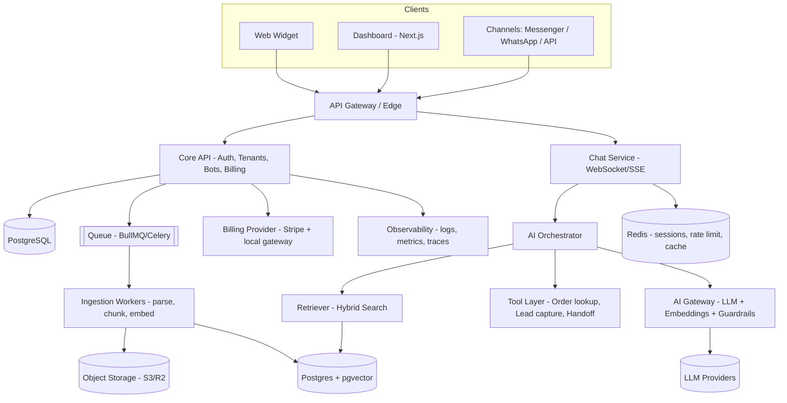

# System Architecture

**Product:** NicheDesk | **Version:** 0.1 | **Style:** Multi-tenant SaaS, modular monolith → services when needed

---

## 1. Architectural Principles
1. **Multi-tenancy first** — every row, vector, file and cache key is tenant-scoped.
2. **Modular monolith for MVP** — clear module boundaries, easy to split later.
3. **Provider-agnostic AI** — LLM/embedding access only through an internal AI Gateway.
4. **Grounded answers** — the bot answers from retrieved knowledge or tool results only.
5. **Async by default** — ingestion, analytics and webhooks run on queues.
6. **Observable & cost-aware** — every LLM call is traced, metered and attributed to a tenant.

## 2. High-Level Diagram


## 3. Technology Stack (Recommended)
| Layer | Choice | Reason |
|---|---|---|
| Dashboard | Next.js (React), TypeScript, Tailwind, shadcn/ui | Fast dev, SSR, ecosystem |
| Widget | Preact/vanilla TS, Shadow DOM, < 60 KB | Isolated styles, fast load |
| Backend API | Node.js (NestJS) **or** Python (FastAPI) | Pick team strength; FastAPI favored for AI code |
| Realtime | WebSocket / Server-Sent Events | Streaming responses |
| Database | PostgreSQL 16 + pgvector | One DB for relational + vectors in MVP |
| Cache/Queue | Redis + BullMQ (or Celery) | Sessions, rate limiting, jobs |
| Storage | S3-compatible (Cloudflare R2) | Uploaded docs |
| AI | LLM via gateway (OpenAI/Anthropic/Gemini), embedding model, optional reranker | Swap by config |
| Auth | Email+password, OAuth (Google), JWT + refresh, RBAC | Standard |
| Billing | Stripe Billing (+ SSLCommerz/bKash for BD) | Subscriptions & invoices |
| Infra | Docker, GitHub Actions, Fly.io/Render/AWS ECS | Simple → scalable |
| Observability | OpenTelemetry, Sentry, Grafana/Loki, LLM tracing (Langfuse) | Debug + cost |

## 4. Core Modules
| Module | Responsibility |
|---|---|
| **Identity & Tenancy** | Users, workspaces, roles (Owner, Admin, Agent), API keys |
| **Bot Management** | Bot config, niche pack, persona, widget theme, channels |
| **Knowledge Service** | Source management, parsing, chunking, embeddings, re-index |
| **Chat Service** | Sessions, message streaming, typing, rate limit, history |
| **AI Orchestrator** | Prompt assembly, retrieval, tool calling, guardrails, fallback |
| **Handoff & Inbox** | Escalation, agent assignment, canned replies, notes |
| **Niche Packs** | Config bundles: intents, prompts, tools, forms, KPIs |
| **Billing & Usage** | Plans, metering, limits, invoices, dunning |
| **Analytics** | Event pipeline, dashboards, unanswered-question mining |
| **Admin Console** | Tenant ops, feature flags, abuse review |

## 5. Chat Request Flow (RAG)
1. Widget sends message → Chat Service authenticates via bot public key + domain allowlist.
2. Load session context (last N turns, summary) from Redis/Postgres.
3. **Pre-guardrails:** language detect, PII mask, prompt-injection & abuse check.
4. **Intent routing:** FAQ / order status / lead capture / small-talk / human request.
5. **Retrieval:** hybrid (BM25 + vector) top-k filtered by `tenant_id` + `bot_id` → rerank.
6. **Generation:** LLM with system prompt + niche rules + retrieved context + tools.
7. **Post-guardrails:** citation check, confidence score, policy filter.
8. If confidence < threshold → fallback message + offer handoff.
9. Stream answer to client; persist message, sources, tokens, latency, cost.

## 6. Knowledge Ingestion Pipeline
`Upload/URL → store raw → parse (PDF/DOCX/HTML/CSV) → clean → chunk (300–800 tokens, overlap) → embed → upsert to pgvector → mark source READY`
- Idempotent jobs, retry with backoff, per-source status and error reporting.
- Re-crawl schedule for website sources; content hash to skip unchanged pages.

## 7. Data Model (Core Entities)
```
tenants(id, name, plan_id, status, created_at)
users(id, tenant_id, email, role, ...)
bots(id, tenant_id, name, niche, config_json, public_key, allowed_domains[])
knowledge_sources(id, tenant_id, bot_id, type, uri, status, hash)
knowledge_chunks(id, tenant_id, bot_id, source_id, content, embedding vector, metadata jsonb)
conversations(id, tenant_id, bot_id, channel, customer_ref, status, assigned_agent_id)
messages(id, conversation_id, role, content, sources jsonb, tokens_in, tokens_out, cost, latency_ms)
leads(id, tenant_id, bot_id, name, contact, payload jsonb)
subscriptions(id, tenant_id, plan_id, provider_ref, status, period_end)
usage_events(id, tenant_id, type, qty, ts)
feedback(id, message_id, rating, comment)
```
- **Isolation:** `tenant_id` on every table + Postgres Row-Level Security.
- Index: `(tenant_id, bot_id)`, HNSW index on embeddings, partial indexes on status.

## 8. Niche Pack Design
A niche pack is a versioned config bundle:
```yaml
id: ecommerce_v1
system_prompt_template: prompts/ecommerce.md
tools: [order_status, product_search, return_policy, lead_capture]
forms: [return_request, order_inquiry]
intents: [pricing, delivery, return, tracking, availability]
kpis: [deflection_rate, cart_recovery, csat]
onboarding_checklist: [connect_store, upload_policies, set_delivery_info]
```
Education pack similarly: `admission_info, fee_structure, course_search, schedule, inquiry_form`.

## 9. Security & Privacy
- TLS everywhere; AES-256 at rest; secrets in a vault/secret manager.
- RBAC + audit logs; API key hashing; widget domain allowlist; CORS strict.
- Rate limiting per tenant/IP/session; bot-abuse & spam protection (Turnstile on demand).
- PII redaction before logging/LLM where possible; configurable data retention; export & delete endpoints.
- Prompt-injection defense: treat retrieved text as untrusted; never expose system prompt or other tenants' data; tool calls validated by schema and permissions.
- LLM providers used under no-training / zero-retention terms where available.

## 10. Scalability & Reliability
- Stateless API/Chat pods behind a load balancer; scale horizontally.
- Redis pub/sub for WebSocket fan-out; sticky sessions not required.
- Queue workers scale independently; dead-letter queues.
- Daily DB backups + PITR; restore drills; health checks; graceful degradation (LLM fallback provider, cached FAQ answers).
- Split points when needed: AI Orchestrator, Ingestion, Analytics.

## 11. Environments & CI/CD
- `local` (docker-compose) → `staging` → `production`.
- GitHub Actions: lint, type-check, unit/integration tests, container build, migration check, deploy.
- Feature flags for niche packs & experimental models; blue/green or rolling deploys.

## 12. Observability & Cost Control
- Trace ID per conversation turn; log retrieval hits, prompts (redacted), tokens, latency.
- Dashboards: p95 latency, error rate, resolution rate, cost per conversation, per-tenant margin.
- Alerts: LLM error spikes, queue backlog, cost anomalies, ingestion failures.
- Cost levers: response cache, small-model routing for easy intents, context trimming, per-plan quotas.

## 13. Architecture Decision Records (ADR) — Initial
| ID | Decision | Status |
|---|---|---|
| ADR-001 | Modular monolith over microservices for MVP | Accepted |
| ADR-002 | Postgres + pgvector instead of separate vector DB | Accepted |
| ADR-003 | AI Gateway abstraction over direct provider SDKs | Accepted |
| ADR-004 | RAG-grounded answers with citation + handoff fallback | Accepted |
| ADR-005 | Row-Level Security for tenant isolation | Accepted |
